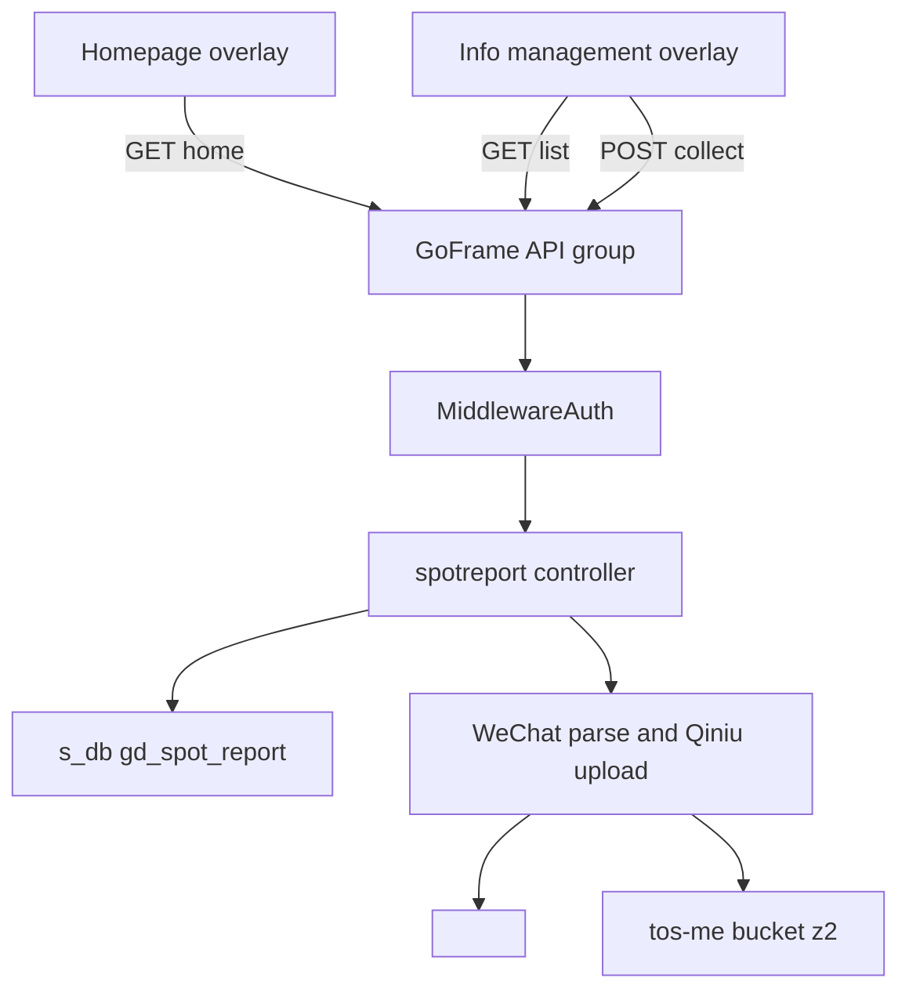

# Technical Design: Guangdong Spot Daily Report

# Overview

OpenLEMS 在首页展示广东电力现货运行日报原图，管理员在管理页「信息管理」粘贴微信公众号链接完成采集。采集结果按运行日写入 SQLite，4 页正文图上传到七牛，键为 `gd-spot/{运行日}/page-{页码}.png`。

前端无 Vue 源码，仅有嵌入的 `web.zip`。本功能不改 zip 包，改为在 `index.html` 运行时注入 overlay 脚本，并额外提供 `/overlay/*` 静态资源。

# Architecture

# API

| Method | Path | Role | Purpose |
| --- | --- | --- | --- |
| GET | `/api/spot-report` | user | 列表，运行日降序 |
| GET | `/api/spot-report/home` | user | 首页默认篇：昨天，否则最近一篇，否则 empty |
| GET | `/api/spot-report/{date}` | user | 单日详情 |
| POST | `/api/spot-report/collect` | admin | 粘贴链接采集，同日覆盖 |

时区一律 `Asia/Shanghai`。昨天 = 该时区当前日期减一天。

采集失败返回 `gcode.CodeInvalidParameter`，文案：

- 非 `<wechat-host>`：`只支持微信公众号文章链接`
- 标题无日期：`标题未包含运行日报日期：{title}`
- 识别不到 4 页图：`文章中没有识别到日报图片`

# Storage

表 `gd_spot_report`：

- `run_date` TEXT UNIQUE，格式 YYYY-MM-DD
- `title` TEXT
- `source_url` TEXT
- `pages` TEXT JSON：`[{page,label,url,key,width,height}]`
- `collected_at` / `created_at` / `updated_at`

页标签固定：

1. 市场概况与日前申报
2. 日前成交与高峰节点电价
3. 低谷节点电价与价格曲线
4. 实时交易电价

七牛配置来自 `qiniu.*` 与环境变量 `QINIU_ACCESS_KEY` / `QINIU_SECRET_KEY` / `QINIU_BUCKET` / `QINIU_DOMAIN` / `QINIU_ZONE`。密钥不入库、不提交。

# Frontend overlay

- `/`：在 `.dashboard-landscape` 顶部插入「电力现货」区块，日期切换 + 左右翻页。
- `/programs`：管理员在 `#cat-Config` 追加「信息管理」卡片。
- `/infoManagement`：overlay 覆盖主内容，列表 / 采集 / 详情。

鉴权头与现网一致：`Authorization: Bearer ${localStorage.ems:user:token}`。

# Collect pipeline

1. 校验 URL 主机名
2. 拉取文章 HTML
3. 读标题，按 `YYYY年M月运行日报(MM.DD)` 解析运行日
4. 从 `#js_content img` 与 `picturePageInfoList` 取图
5. 竖版且宽 >= 1500 的图优先；否则去掉首尾页眉页脚
6. 必须得到 4 页，下载后上传七牛

同日再次采集覆盖 SQLite 行与七牛对象。
